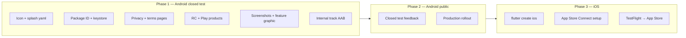

Here is a full production-readiness audit for **Muhūrta** on Google Play and Apple App Store, including what that other GitHub repo gives you and what you still have to do by hand.

---

## Current state (honest scorecard)

| Area | Status | Blocker? |
|------|--------|----------|
| App code & backend | Solid — pack-first flow, Ask, share, RevenueCat wiring | No |
| Subscriptions (code) | RevenueCat SDK + webhook + `subscriptions` table | No |
| Subscriptions (stores) | Products not created in Play/App Store + RC dashboard | **Yes** |
| Android package ID | Still `com.example.muhurta` | **Yes** |
| Android release signing | Release uses **debug** keystore | **Yes** |
| App icon | Default **Flutter logo** on all mipmaps | **Yes** |
| Adaptive icon (Android 8+) | Missing | **Yes** |
| iOS project | **`app/ios/` does not exist** | **Yes** for App Store |
| Store screenshots | None in repo; `docs/screenshots/` gitignored | **Yes** |
| Feature graphic (Play) | Missing | **Yes** |
| Privacy policy URL | Not linked in app; `muhurta.app/privacy` timed out | **Yes** |
| Terms of service | Not in app | Recommended |
| Version | `0.1.0+1` — fine for internal test, bump for public | Soft |
| CI/CD store upload | None (manual builds only) | No |

**Bottom line:** The product is close on functionality, but **not store-submittable yet**. Play Store is ~1–2 focused weeks; App Store adds iOS scaffold + Apple Developer setup.

---

## Google Play CLI (automated after first upload)

We use **[GPC](https://github.com/yasserstudio/gpc)** (`tools/gpc/gpc.exe`, gitignored binary) — not an official Google tool, but the most complete Play Developer API CLI (subscriptions, listings, AAB upload, rollouts).

| Script | Purpose |
|--------|---------|
| `scripts/setup-google-play.ps1` | Download GPC, create upload keystore, auth with service account |
| `scripts/build-release-aab.ps1` | `flutter build appbundle --release` |
| `scripts/publish-play-internal.ps1` | `gpc publish` → internal track |
| `scripts/sync-play-subscriptions.ps1` | `gpc monetization sync` from `play/monetization/subscriptions.yaml` |

**Package ID:** `app.muhurta` (updated in Android project)

**One-time UI only:** create app in [Play Console](https://play.google.com/console) + first AAB upload — see `play/MANUAL_FIRST_UPLOAD.md`.

**Screenshots at scale:** [adil192/golden_screenshot](https://github.com/adil192/golden_screenshot) → Fastlane metadata folders.

---

## The online repos for store assets + publishing

These are **public** GitHub projects (not your `muhurtha` repo):

| Repo | What it does | Need it? |
|------|----------------|----------|
| [fluttercommunity/flutter_launcher_icons](https://github.com/fluttercommunity/flutter_launcher_icons) | One master PNG → all Android mipmaps + iOS AppIcon sizes | **Yes** for icons |
| [adil192/golden_screenshot](https://github.com/adil192/golden_screenshot) | Golden tests → Play/App Store screenshots in **Fastlane** folder layout (`metadata/en-US/images/phoneScreenshots/`) | **Recommended** for screenshots at scale |
| [microservicer/flutter-pipelines](https://github.com/microservicer/flutter-pipelines) | Full GitOps: build → screenshots → Fastlane deliver to Play internal + TestFlight | Optional later for CI/CD |
| Fastlane + GitHub Actions | Upload AAB/IPA + metadata (see [Codemagic screenshots guide](https://docs.codemagic.io/knowledge-codemagic/flutter-screenshots-stores/)) | Optional for automated pushes |

**Can you ship without them?**

- **Icons:** No — you need real icons somehow (`flutter_launcher_icons` is the standard path; copy yaml pattern from your [invoice-pe-flutter](https://github.com/prasanthkuna/invoice-pe-flutter) repo).
- **Screenshots:** Yes manually (phone screenshots) — but `golden_screenshot` saves hours and keeps locales/devices consistent.
- **Play upload:** Yes manually via Play Console — automation repos only help after first manual upload.

**Recommended stack for Muhūrta:**

1. `flutter_launcher_icons` + `flutter_native_splash` (icons + splash)
2. `golden_screenshot` (store screenshots → Fastlane metadata folders)
3. Manual first `.aab` upload to Play Console
4. Add `microservicer/flutter-pipelines` or Fastlane later when you want one-click releases

---

## The “asset repo” on GitHub — what it actually is (your repos)

There is **no separate asset-generator repo** in your GitHub account for Muhūrta. What you likely mean is your other Flutter app:

**[invoice-pe-flutter](https://github.com/prasanthkuna/invoice-pe-flutter)**

That repo has the **standard Flutter asset pipeline**, not magic auto-screenshots:

| File | What it generates |
|------|-------------------|
| `flutter_launcher_icons.yaml` | All launcher icons (Android mipmaps, iOS AppIcon, web, etc.) from one master image |
| `flutter_native_splash.yaml` | Branded native splash (incl. Android 12+) |
| `assets/icons/app_icon.webp` | Master icon source |
| `assets_original/` | Design source files |

It does **not** generate Play Store screenshots, feature graphics, or App Store preview videos.

### Do you need it?

| Asset type | Need invoice-pe pattern? | Alternative |
|------------|--------------------------|-------------|
| Launcher icon (all densities) | **Strongly yes** — copy the yaml approach into muhurtha | Manual export from Figma into every mipmap + AppIcon size (painful) |
| Native splash | **Yes** — same `flutter_native_splash` | Plain white splash (current) — looks unfinished |
| Store listing icon 512×512 | One export from same master | Same master PNG |
| Phone screenshots (2–8) | **No** — yaml cannot do this | Real device / emulator captures |
| Play feature graphic 1024×500 | **No** | Figma/Canva one-off |
| App Store screenshots per device | **No** | Simulator captures at required resolutions |

**Recommendation:** Copy the **tooling pattern** from `invoice-pe-flutter` into muhurtha (`flutter_launcher_icons` + `flutter_native_splash` + `assets/icons/`). You still need to **design one master icon** first (per `MUHURTA_DESIGN.md` §18 — thin-line, moon/sun metaphors, cream/gold palette). Screenshots are always manual or semi-automated (Maestro can help later).

---

## Subscription cross-check

### What’s wired in code

```1:15:app/lib/core/subscription/subscription_constants.dart
/// RevenueCat identifiers — must match the RevenueCat dashboard exactly.
abstract final class SubscriptionConstants {
  /// Entitlement created in RevenueCat (Products → Entitlements).
  static const entitlementPro = 'muhurtha Pro';

  /// Default offering identifier in RevenueCat.
  static const defaultOffering = 'default';

  /// Package identifiers inside the offering (monthly / yearly).
  static const packageMonthly = 'monthly';
  static const packageYearly = 'yearly';

  /// Maps to `subscriptions.plan_code` on the server.
  static const serverPlanPro = 'pro';
}
```

- Flutter: `purchases_flutter` + native paywall + restore + Customer Center
- Backend: `subscription_sync` + `revenuecat-webhook` edge function
- Android: `BILLING` permission present
- Keys: `REVENUECAT_ANDROID_KEY` / `REVENUECAT_IOS_KEY` in gitignored `dart_defines.json`

### Gaps to fix before launch

1. **Tier mismatch** — UI/l10n still says **Plus + Pro** (`paywallSubtitle`, `paywallCtaPlus`), but RevenueCat only sells **one entitlement: `muhurtha Pro`**. Pick one for v1:
   - **Option A (simpler):** Ship Pro-only at ₹199/mo — update all paywall strings
   - **Option B:** Create Plus + Pro in Play Console, map both in RevenueCat (matches `docs/upgrades/subscription.md`)

2. **Store products** — Create subscriptions in Play Console / App Store Connect, then link in RevenueCat dashboard (steps in `docs/debug-guide.md` § RevenueCat).

3. **Webhook secret** — Confirm `REVENUECAT_WEBHOOK_SECRET` is set on Supabase prod.

4. **Subscription disclosure** — Play and Apple require clear pricing, renewal terms, and links to privacy + terms on/near the paywall.

5. **Data safety / App Privacy** — Declare: phone number, birth data, location, purchase history, analytics (if any).

---

## Master checklist: Play Store

### A. Identity & signing (blockers)

- [ ] Choose final package ID — e.g. `app.muhurta` or `com.muhurta.app` (cannot change after first upload)
- [ ] Update `applicationId`, `namespace`, and Kotlin package path in `build.gradle.kts` + `MainActivity.kt`
- [ ] Create upload keystore; add `android/key.properties` (gitignored)
- [ ] Wire release `signingConfig` in `build.gradle.kts` (remove debug signing)
- [ ] Bump version: e.g. `1.0.0+1` in `pubspec.yaml`

### B. Visual assets (blockers)

- [ ] Design master icon 1024×1024 (no transparency for Play listing)
- [ ] Add `flutter_launcher_icons.yaml` + run generator (copy pattern from invoice-pe-flutter)
- [ ] Add adaptive icon foreground + background (cream `#F5F0E8` / gold accent per design system)
- [ ] Add `flutter_native_splash.yaml` — moon ☽ or minimal wordmark on dark cream
- [ ] Capture **2–8 phone screenshots** (1080×1920 or higher): Today, Decode, Timing, Life Map, Ask, Share card
- [ ] Create **feature graphic** 1024×500
- [ ] Set manifest label to **Muhūrta** (not lowercase `muhurta`)

### C. Store listing copy

- [ ] Short description (80 chars) — e.g. “Check your past. Choose the right time.”
- [ ] Full description — past-proof + daily timing + Jyotish (not generic horoscope)
- [ ] Category: Lifestyle or Health & Fitness
- [ ] Content rating questionnaire
- [ ] Contact email: `support@muhurta.app`

### D. Legal & compliance (blockers)

- [ ] Host **privacy policy** at `https://muhurta.app/privacy` (birth data, phone, location, subscriptions)
- [ ] Host **terms** at `https://muhurta.app/terms`
- [ ] Link both in app: paywall footer + profile/settings
- [ ] Data safety form: personal info, financial info (purchases), data encryption, deletion request path
- [ ] Target audience / children: likely 18+ (astrology + birth data)

### E. Subscriptions (Play)

- [ ] Create `monthly` + `yearly` subscription products in Play Console
- [ ] Map to RevenueCat entitlement `muhurtha Pro`
- [ ] Configure base plan prices (₹199/mo, ₹999/yr per your pricing doc — or simplify to one tier)
- [ ] Test with license testers before production

### F. Build & upload

```powershell
cd c:\Users\PrashanthKuna\muhurtha\app
flutter build appbundle --release --dart-define-from-file=dart_defines.json
# Output: build\app\outputs\bundle\release\app-release.aab
```

- [ ] Internal testing track first → closed testing → production
- [ ] Update `ANDROID_SMS_APP_HASH` in Supabase for **release** keystore (OTP autofill)

---

## Master checklist: App Store

### A. Platform (biggest gap)

- [ ] `cd app; flutter create --platforms=ios .` (adds `ios/` folder)
- [ ] Apple Developer account ($99/yr)
- [ ] Bundle ID matching Android strategy
- [ ] Xcode signing + provisioning profiles
- [ ] `REVENUECAT_IOS_KEY` (`appl_…`) in `dart_defines.json`

### B. iOS-specific assets

- [ ] AppIcon.appiconset (1024×1024 + all sizes — `flutter_launcher_icons` handles this)
- [ ] Launch screen (native splash yaml)
- [ ] Screenshots: 6.7" (1290×2796), 6.5" (1284×2778) minimum; iPad if supporting tablet
- [ ] App Privacy “nutrition labels” in App Store Connect
- [ ] Subscription group in App Store Connect + RevenueCat mapping

### C. iOS review extras

- [ ] Sign in with Apple — **not required** if you only use phone OTP, but document test account for reviewers
- [ ] Provide demo phone + OTP path in App Review notes
- [ ] Export compliance / encryption (usually “uses HTTPS only”)

---

## Recommended phased plan



| Phase | Goal | Est. effort |
|-------|------|-------------|
| **1** | Play internal testing with real subscriptions | 3–5 days |
| **2** | Play production (India first) | 1–2 days after review |
| **3** | iOS scaffold + TestFlight | 5–7 days |
| **4** | App Store public | After TestFlight validation |

---

## What to add to the muhurtha repo (suggested)

When you’re ready to implement, add to muhurtha (mirroring invoice-pe-flutter):

```
app/
  assets/icons/
    app_icon.png          # 1024×1024 master
    app_icon_foreground.png
  flutter_launcher_icons.yaml
  flutter_native_splash.yaml
  store/                  # optional, gitignored or committed
    screenshots/
    feature_graphic.png
docs/
  store-release-checklist.md   # this plan as a living doc
```

`pubspec.yaml` dev_dependencies:

```yaml
dev_dependencies:
  flutter_launcher_icons: ^0.14.3
  flutter_native_splash: ^2.4.4
```

Screenshots: capture on your device `10BF441Y76003GL` with Telugu + English profiles — store reviewers and users respond better to real localized UI.

---

## Quick answers to your specific questions

1. **“Repo that generates all assets”** — That’s the **`flutter_launcher_icons` + `flutter_native_splash` pattern** in `invoice-pe-flutter`, not a standalone generator. Reuse that approach in muhurtha.

2. **“Can we do without it?”** — You can skip the yaml **only if** you manually export every icon size and splash asset. That’s slower and error-prone. You **cannot** skip having a real icon, screenshots, and feature graphic — stores will reject the default Flutter logo.

3. **Subscriptions** — Code is ready; stores + RevenueCat dashboard + legal pages + tier copy alignment are the remaining work.